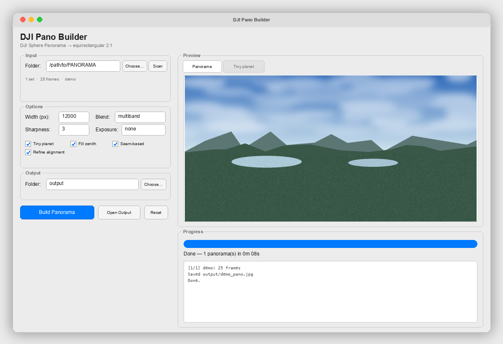

# DJI Pano Builder

A quality stitcher for DJI drone spherical panoramas (Sphere Panorama / 360 mode).
Turn a folder of `PANO*.JPG` frames into a standard **2:1 equirectangular**
panorama with Google Photo Sphere (GPano) metadata.



---

## English

### What it is

DJI stores a spherical panorama as a set of separate frames `PANO0001.JPG …
PANO0025.JPG` (usually 3 rings × 8 frames + one nadir). Each frame's XMP
metadata already contains the **exact gimbal orientation**:
`GimbalYawDegree`, `GimbalPitchDegree`, `GimbalRollDegree`.

The stitcher uses that orientation directly: every frame is reprojected onto a
sphere instead of being matched by features. The result is an even, globally
consistent panorama without drift or geometry doubling.

The stitching logic lives in **one shared package** (`djipano/`), used by both
the native GUI and the command-line tool — so there is only one place to change.

### Features

* Native **Tkinter GUI** with folder picker, live progress bar, ETA, log and
  panorama / tiny-planet preview.
* Accurate stitching from XMP gimbal angles (no feature matching).
* **Pose refinement** — per-frame rotation corrections estimated from the
  overlaps, so the horizon and seams line up.
* Standard 2:1 equirectangular output + GPano XMP + GPS/EXIF.
* **Multiband (Laplacian pyramid) blending** — smooth seams, sharp detail.
* **Seam-based assignment** — each pixel comes from one frame, which removes
  ghosting in overlapping areas.
* Adjustable seam sharpness (`--sharpness`).
* Smooth zenith fill via colour diffusion (Laplace equation).
* Optional exposure equalisation over overlaps (`--exposure auto`).
* "Tiny planet" preview.
* Batch mode: point it at a root folder and every set is processed.
* Pretty English CLI with progress bar, ETA and spinners.
* Tolerates missing frames: a missing shot does not break the stitch.

### Requirements

* Python 3.9+
* `numpy`
* `Pillow`
* `scipy` (pose refinement)
* Tkinter **only for the GUI** (on macOS/Homebrew: `brew install python-tk@3.14`;
  Debian/Ubuntu: `sudo apt install python3-tk`; Windows: official python.org
  installer already includes it)

```bash
pip install -r requirements.txt
```

### GUI

```bash
python3 dji_pano_gui.py
```

Pick a folder (or a root folder with several `PANO*` sets), adjust the options
and press **Build panorama**. The progress bar, log and a preview of the result
appear in the same window.

### CLI

```bash
# a single folder
python3 dji_pano.py PANORAMA/006_0004 -o 006_0004_pano.jpg

# with a tiny-planet preview
python3 dji_pano.py PANORAMA/006_0004 -o 006_0004_pano.jpg --preview

# batch: every subfolder containing PANO*.JPG
python3 dji_pano.py PANORAMA --out-dir output -w 12000 --preview
```

### Options

| Option | Description | Default |
|--------|-------------|---------|
| `-o, --output` | output JPEG path (single folder) | — |
| `-w, --width` | panorama width in pixels (height = width / 2) | `12000` |
| `--preview` | also save a "tiny planet" preview | off |
| `--no-fill` | do not fill the zenith gap | off |
| `--exposure {none,auto}` | brightness correction | `none` |
| `--blend {multiband,linear}` | blending mode | `multiband` |
| `--sharpness N` | seam sharpness (higher = narrower) | `3` |
| `--no-seam` | disable seam-based assignment | off |
| `--no-refine` | disable pose refinement | off |
| `--out-dir DIR` | output folder for batch mode | `.` |
| `--no-color` | disable coloured output | off |
| `-q, --quiet` | only print errors | off |

### How it works

1. Read `GimbalYaw/Pitch/Roll` (XMP) and focal length (EXIF) from each frame.
   Compute intrinsics `fx, fy` from the camera sensor size.
2. Build a camera-to-world rotation matrix (ENU) per frame.
3. **Refine** the per-frame rotations by matching overlapping frames on the
   sphere (robust bundle adjustment) — this removes the residual ~0.5° gimbal
   error that makes horizons crooked.
4. Fill the equirect map by inverse mapping: for each sphere pixel find the ray
   direction, transform it into the frame and bilinearly sample.
5. Find a seam assignment (which frame owns each pixel) and blend with
   multiband Laplacian pyramids: fine detail from one frame, smooth low
   frequencies across the seam.
6. Fill uncovered areas (zenith) by colour diffusion.
7. Save a 2:1 JPEG with GPano XMP and source GPS/EXIF.

### Project structure

```
djipano/            shared core package (imported by both entry points)
├── metadata.py     XMP/EXIF/GPano, Camera
├── geometry.py     rotations, equirectangular reprojection
├── blending.py     exposure, multiband, seams, hole filling
├── pipeline.py     build_panorama + folder discovery
├── progress.py     terminal progress bar / spinner
├── cli.py          command-line interface
└── gui.py          native Tkinter GUI
dji_pano.py         CLI entry point
dji_pano_gui.py     GUI entry point
```

### Automated build (GitHub Actions)

`.github/workflows/build.yml` checks imports on Linux/macOS/Windows and builds
standalone executables with PyInstaller. Every push to `main` updates the
**[Latest build](https://github.com/skibidius/DJIPanoBuilder/releases/tag/latest)**
pre-release with `dji-pano-builder-*` binaries for Linux, macOS and Windows;
pushing a `v*` tag creates a versioned release.

### About the DJI Sphere format

A standard DJI set is **25 frames**: 3 rings × 8 frames (pitch ≈ +20°, −17°,
−55°) plus one nadir frame (pitch ≈ −90°). The zenith (pitch > +48°) is not
captured, so it is physically absent from the source data — the script
reconstructs it with a smooth fill. If the sky is overexposed (white), the
patch is invisible.

If a frame is missing (e.g. 24 files instead of 25), the panorama still
stitches, but a soft blurred patch appears where the data is absent.

### Performance & memory

* Default `-w 12000` with multiband blending uses roughly **8 GB of RAM** and
  takes **~2–3 minutes** per panorama on Apple Silicon.
* If memory is tight, use `-w 8000` and/or `--blend linear`.
* Batch mode processes folders sequentially, so peak memory does not add up.

### License

MIT. See [LICENSE](LICENSE).

---

## Русский

Сборка качественной сферической панорамы из набора снимков дрона DJI
(режим **Sphere Panorama** / «Панорама 360»).

### Что это

DJI сохраняет панораму как набор отдельных кадров `PANO0001.JPG … PANO0025.JPG`
(обычно 3 кольца по 8 кадров + надир). В XMP-метаданных каждого кадра уже
записаны **точные углы подвеса**: `GimbalYawDegree`, `GimbalPitchDegree`,
`GimbalRollDegree`.

Скрипт использует эту ориентацию напрямую: каждый кадр перепроецируется на
сферу, а не «склеивается» по общим точкам. Панорама получается ровной, без
накопления ошибки и «двоения» геометрии.

Вся логика сборки живёт в **одном общем пакете** (`djipano/`), который
используют и GUI, и командная строка — менять код нужно в одном месте.

### Возможности

* Нативный **GUI на Tkinter**: выбор папки, прогресс-бар, ETA, лог и превью
  панорамы / «маленькой планеты».
* Точная сборка по углам подвеса из XMP (без feature matching).
* **Уточнение позы** — поправки поворота каждого кадра по перекрытиям, чтобы
  горизонт и швы сходились ровно.
* Стандартный выход 2:1 equirectangular + XMP GPano + GPS/EXIF.
* **Многополосное (Laplacian pyramid) смешивание** — гладкие швы и резкие детали.
* **Шовное назначение пикселей** — каждый пиксель берётся из одного кадра,
  что убирает гостинг в зонах перекрытия.
* Регулируемая резкость шва (`--sharpness`).
* Аккуратное заполнение зенита диффузией цвета.
* Опциональное выравнивание яркости по перекрытиям (`--exposure auto`).
* Превью «маленькая планета».
* Пакетная обработка всех подпапок.
* Английский CLI с прогресс-баром, ETA и спиннерами.
* Устойчивость к пропущенным кадрам.

### Требования

* Python 3.9+
* `numpy`
* `Pillow`
* `scipy` (уточнение позы)
* Tkinter **только для GUI** (macOS/Homebrew: `brew install python-tk@3.14`;
  Debian/Ubuntu: `sudo apt install python3-tk`; Windows: официальный установщик
  python.org уже содержит Tk)

```bash
pip install -r requirements.txt
```

### GUI

```bash
python3 dji_pano_gui.py
```

Выберите папку (или корневую папку с несколькими наборами `PANO*`), настройте
опции и нажмите **Build panorama**. Прогресс, лог и превью появятся в том же окне.

### CLI

```bash
# одна папка с кадрами
python3 dji_pano.py PANORAMA/006_0004 -o 006_0004_pano.jpg

# с превью «маленькая планета»
python3 dji_pano.py PANORAMA/006_0004 -o 006_0004_pano.jpg --preview

# пакетно: все подпапки с PANO*.JPG
python3 dji_pano.py PANORAMA --out-dir output -w 12000 --preview
```

### Опции

| Опция | Описание | По умолчанию |
|-------|----------|--------------|
| `-o, --output` | путь к выходному JPEG | — |
| `-w, --width` | ширина панорамы (высота = ширина / 2) | `12000` |
| `--preview` | сохранить превью «маленькая планета» | выкл. |
| `--no-fill` | не заполнять дыру в зените | выкл. |
| `--exposure {none,auto}` | коррекция яркости | `none` |
| `--blend {multiband,linear}` | режим смешивания | `multiband` |
| `--sharpness N` | резкость шва | `3` |
| `--no-seam` | отключить шовное назначение | выкл. |
| `--no-refine` | отключить уточнение позы | выкл. |
| `--out-dir DIR` | папка результатов | `.` |
| `--no-color` | отключить цветной вывод | выкл. |
| `-q, --quiet` | только ошибки | выкл. |

### Как это работает

1. Из каждого кадра читаются `GimbalYaw/Pitch/Roll` (XMP) и фокусное
   расстояние (EXIF). По размеру сенсора вычисляются `fx, fy`.
2. Для каждого кадра строится матрица поворота «камера → мир» (ENU).
3. **Уточнение позы**: повороты кадров корректируются по совпадениям на сфере
   (робастный bundle adjustment) — это убирает остаточную ошибку подвеса ~0.5°,
   из-за которой горизонт выглядит криво на стыках.
4. Выходная equirect-карта заполняется обратным отображением.
5. Строится карта «владения» пикселей (какой кадр главный) и выполняется
   многополосное смешивание: мелкие детали из одного кадра, низкие частоты
   плавно смешиваются через шов.
6. Непокрытые области (зенит) заполняются диффузией цвета.
7. Результат сохраняется как 2:1 JPEG с XMP GPano и GPS/EXIF.

### Структура проекта

```
djipano/            общий пакет с логикой
├── metadata.py     XMP/EXIF/GPano, камера
├── geometry.py     повороты, equirect-проекция
├── blending.py     экспозиция, многополосное смешивание, швы, зенит
├── pipeline.py     build_panorama + поиск папок
├── progress.py     прогресс-бар / спиннер
├── cli.py          командная строка
└── gui.py          нативный GUI на Tkinter
dji_pano.py         точка входа CLI
dji_pano_gui.py     точка входа GUI
```

### Автоматическая сборка (GitHub Actions)

`.github/workflows/build.yml` проверяет импорты на Linux/macOS/Windows и
собирает standalone-бинарники через PyInstaller. Каждый пуш в `main`
обновляет pre-release
**[Latest build](https://github.com/skibidius/DJIPanoBuilder/releases/tag/latest)**
с файлами `dji-pano-builder-*` для Linux, macOS и Windows; пуш тега `v*`
создаёт версионированный релиз.

### Про формат DJI Sphere

Стандартный набор DJI — **25 кадров**: 3 кольца по 8 кадров (pitch ≈ +20°,
−17°, −55°) и один надир (pitch ≈ −90°). Зенит (pitch > +48°) не снимается,
поэтому его физически нет — скрипт достраивает его плавным заполнением.

Если в наборе не хватает одного кадра, панорама всё равно соберётся, но в
месте пропуска останется мягкое размытое пятно.

### Производительность и память

* `-w 12000` с многополосным смешиванием: ~**8 ГБ ОЗУ**, ~**2–3 минуты** на
  панораму (Apple Silicon).
* Если памяти мало — `-w 8000` и/или `--blend linear`.
* Пакетный режим обрабатывает папки последовательно.

### Лицензия

MIT. См. [LICENSE](LICENSE).
